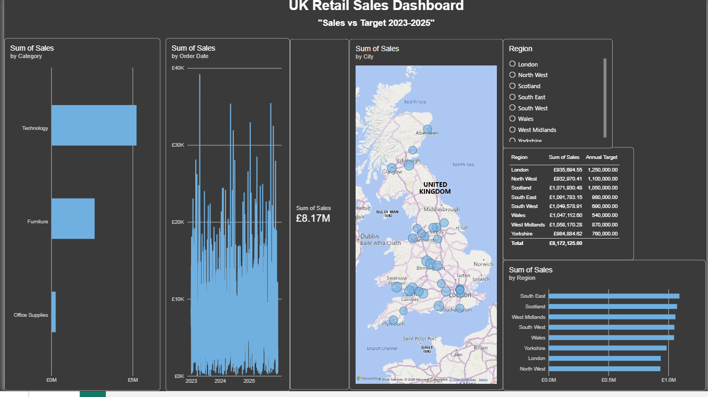

# UK Regional Sales Performance — Interactive Power BI Report

An interactive Power BI report analysing UK retail sales against regional targets for
2023–2025. Built end-to-end in Power BI Desktop: data cleaning in Power Query, a
star-schema data model, DAX measures (including time intelligence), and an
interactive dashboard with slicers, cross-filtering and drill-through.

---

## Overview

This project takes raw retail transaction data and regional sales targets and turns
them into a single, interactive management dashboard that answers three business
questions at a glance:

- **How are we selling** — total sales, sales by product category, and the sales
  trend over time (2023–2025)?
- **Where are we selling** — sales by UK city (map) and by region?
- **Are we hitting target** — actual sales vs annual target per region, the variance,
  and year-on-year growth.

## Dataset

| File | Description | Rows |
|------|-------------|------|
| `UK_Retail_Sales.csv` | Retail transactions (Order Date, City, Region, Category, Sales, Quantity, etc.) | ~6,200 |
| `UK_Region_Targets.csv` | Annual sales target for each of the 8 UK regions | 8 |

*A sample dataset used for a portfolio / learning project — no real customer data.*

## Tools & techniques

- **Power Query (ETL):** cleaned the source data — corrected data types, trimmed and
  standardised text, removed duplicates and handled blanks, and reshaped the targets
  table so it could be modelled.
- **Data modelling (star schema):** related a `UK_Retail_Sales` fact table to a
  `UK_Region_Targets` dimension (one-to-many on Region) and a dedicated `Calendar`
  date table (marked as the date table) for reliable time intelligence.
- **DAX measures:**
  - `Total Sales = SUM(UK_Retail_Sales[Sales])`
  - `Total Target = SUM(UK_Region_Targets[Annual Target])`
  - `Variance = [Total Sales] - [Total Target]`
  - `% of Target = DIVIDE([Total Sales], [Total Target])`
  - **Year-on-year growth** using `SAMEPERIODLASTYEAR` over the Calendar table.
- **Interactivity:** a Region slicer, visual cross-filtering (edit interactions), and
  **drill-through** from the dashboard to a detailed regional performance page.
- **Formatting:** a dark theme, report title, KPI card, and a performance matrix with
  **traffic-light conditional formatting** on the variance.

## What's in the report

**Page 1 — Dashboard**
- KPI card: total sales (£8.17M)
- Sales by product category (bar)
- Sales trend by order date (2023–2025)
- Sales by UK city (map)
- Sales vs annual target per region (matrix)
- Sales by region (bar)
- Region slicer + cross-filtering across every visual

**Page 2 — Regional performance (drill-through)**
- A detailed performance matrix: sales, target, variance and % of target by region,
  with conditional formatting — reachable by right-clicking a region and drilling through.

## How to open

1. Install [Power BI Desktop](https://powerbi.microsoft.com/desktop/) (free, Windows).
2. Download `UK Sale Report.pbix` from this repository and open it.
3. The map is a Bing bubble map, so an internet connection is needed for it to render.

## Author

**Bekir Onal** — Data Analyst
[LinkedIn](https://www.linkedin.com/in/bekir-onal-63b557250) · [GitHub](https://github.com/bekir35-on)
